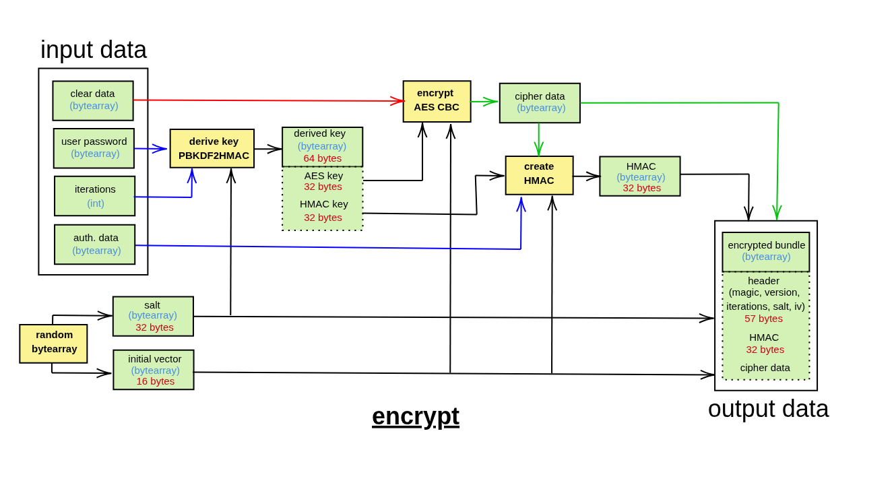
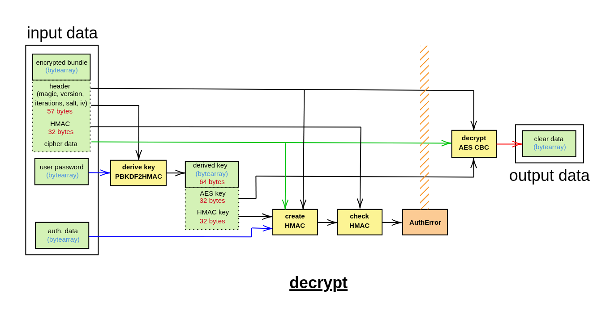

# pyaescbc

AES-256-CBC + HMAC-SHA256 encryption of `bytearray` data, built on the
[`cryptography`](https://cryptography.io) package.

`pyaescbc` encrypts and authenticates data (Encrypt-then-MAC) behind a small API, in two modes:

- **Password mode** (`encrypt` / `decrypt`): the key is derived from a password with
  PBKDF2-HMAC-SHA256. Slow on purpose, to resist brute-force attacks.
- **Key mode** (`encrypt_with_key` / `decrypt_with_key`): the data is encrypted with a random
  32-byte key, without key derivation. It takes microseconds, which makes it suited to
  encrypting many small secrets (see [envelope encryption](#key-mode-envelope-encryption)).

Both modes authenticate the data: a wrong password or key, wrong additional data, or any
modification of the encrypted bundle is detected before anything is decrypted.

## Security considerations

> [!WARNING]
> **Consider AES-GCM for new projects.**
> `pyaescbc` implements AES-256-CBC with HMAC-SHA256 (Encrypt-then-MAC). This construction
> is secure when assembled correctly, but it requires several hand-assembled parts
> (padding, HMAC, key separation, constant-time comparison).
> For new projects, prefer an authenticated encryption mode (AEAD) such as
> [`AESGCM`](https://cryptography.io/en/latest/hazmat/primitives/aead/#cryptography.hazmat.primitives.ciphers.aead.AESGCM)
> or [`ChaCha20Poly1305`](https://cryptography.io/en/latest/hazmat/primitives/aead/#cryptography.hazmat.primitives.ciphers.aead.ChaCha20Poly1305)
> from the `cryptography` library, which provide confidentiality and integrity in a single primitive.
>
> **Memory wiping is best-effort.** Python cannot guarantee that secrets are erased from memory
> (immutable copies may be created by the interpreter or by the underlying libraries).

## Installation

Requires Python 3.11 or later.

```
pip install pyaescbc
```

Or the development version:

```
pip install git+https://github.com/Artezaru/pyaescbc.git
```

## Usage

All data, passwords and keys are `bytearray` objects, so that they can be wiped from memory
after use.

### Password mode

```python
import pyaescbc

# Encryption
cleardata = bytearray("Hello, World!", "utf-8")
password = bytearray("password", "utf-8")
authdata = bytearray("user=toto", "utf-8")  # optional additional authenticated data
encrypted_bundle = pyaescbc.encrypt(cleardata, password, authdata=authdata, iterations=2_000_000)

# Decryption (the number of iterations is read from the bundle)
password = bytearray("password", "utf-8")
authdata = bytearray("user=toto", "utf-8")  # same value as for encryption
decrypted_data = pyaescbc.decrypt(encrypted_bundle, password, authdata=authdata)

print(decrypted_data)  # bytearray(b'Hello, World!')
```

- `iterations` sets the cost of the PBKDF2 derivation: 600 000 by default
  (`pyaescbc.DEFAULT_ITERATIONS`), between `MIN_ITERATIONS` (100 000) and `MAX_ITERATIONS`
  (100 000 000). It is stored in the bundle.
- `authdata` is authenticated but neither encrypted nor stored: the same value must be given
  to decrypt. It is useful to bind the data to a context (a user, a record, a field).
- By default, `encrypt` wipes `cleardata` and `password` once the encryption succeeded, and
  `decrypt` wipes `password`. Use `delete_data=False` / `delete_keys=False` to keep them.





### Key mode (envelope encryption)

The password mode runs a slow key derivation on every call. To encrypt many secrets, use a
random **data key** with the key mode, and protect that key once with the password:

```python
import pyaescbc

# Creation: a random data key, wrapped with the password (slow, once)
data_key = pyaescbc.generate_key()
wrapped_key = pyaescbc.encrypt(data_key.copy(), bytearray("password", "utf-8"))

# Each secret is encrypted with the data key (fast, no key derivation)
secret = pyaescbc.encrypt_with_key(
    bytearray("my secret", "utf-8"),
    data_key,
    authdata=bytearray("entry=42", "utf-8"),  # optional
)
pyaescbc.delete_bytearray(data_key)

# Next session: unwrap the data key once, then decrypt any secret quickly
data_key = pyaescbc.decrypt(wrapped_key, bytearray("password", "utf-8"))
print(pyaescbc.decrypt_with_key(secret, data_key, authdata=bytearray("entry=42", "utf-8")))

# Changing the password only re-wraps the data key: the secrets are not re-encrypted
wrapped_key = pyaescbc.encrypt(data_key.copy(), bytearray("new password", "utf-8"))

pyaescbc.delete_bytearray(data_key)  # end of the session
```

- The key must come from `pyaescbc.generate_key()`. **Never use a password as key**: it would
  get no brute-force protection.
- The key is kept by default (`delete_keys=False`), since it is reused for many messages.
- To make an old password useless even against old copies of the data, generate a new data
  key and re-encrypt the secrets with it: this is fast in key mode.

### Errors

```python
try:
    cleardata = pyaescbc.decrypt(encrypted_bundle, password)
except pyaescbc.AuthError:
    ...  # wrong password or authdata, or the bundle has been tampered with
except ValueError:
    ...  # not a valid bundle (wrong size, unknown format or version, bundle of the other mode)
```

A bundle of one mode passed to the other mode is rejected with an explicit `ValueError`
(for example: *"this is a key-mode bundle, use decrypt_with_key()"*).

### Storing a bundle

An encrypted bundle is binary data. Store it as bytes in a file or a database, or convert it
to text with base64:

```python
import base64

text = base64.b64encode(encrypted_bundle).decode("ascii")
encrypted_bundle = bytearray(base64.b64decode(text))
```

## Public API

| Name | Description |
| --- | --- |
| `encrypt`, `decrypt` | Password mode |
| `encrypt_with_key`, `decrypt_with_key` | Key mode |
| `generate_key`, `KEY_SIZE` | Random 32-byte key for the key mode |
| `DEFAULT_ITERATIONS`, `MIN_ITERATIONS`, `MAX_ITERATIONS` | PBKDF2 settings of the password mode |
| `AuthError` | Raised when the authentication fails |
| `delete_bytearray` | Wipes a `bytearray` (best-effort) |

Only these names are public. The building blocks that were public in pyaescbc 2.1 and earlier
(`derive_key`, `create_hmac`, `random_iv`, ...) are now internal: they still work but emit a
`DeprecationWarning`, and will be removed in the next major version.

## Bundle formats

Both formats share the layout `header | HMAC-SHA256 (32 bytes) | AES-256-CBC cipherdata`; the
header is authenticated by the HMAC.

| Mode | Magic | Header |
| --- | --- | --- |
| Password | `PACB` | magic (4) · version 2 (1) · iterations (4) · salt (32) · IV (16) = 57 bytes |
| Key | `PACK` | magic (4) · version 1 (1) · IV (16) = 21 bytes |

Bundles created by previous versions of `pyaescbc` (format version 2) can still be decrypted.
The complete specification is in the [online documentation](https://Artezaru.github.io/pyaescbc).

## Authors

- Artezaru <artezaru.github@proton.me>

- **Git Platform**: https://github.com/Artezaru/pyaescbc.git
- **Online Documentation**: https://Artezaru.github.io/pyaescbc

## License

Copyright 2025 Artezaru

Licensed under the Apache License, Version 2.0 (the "License");
you may not use this file except in compliance with the License.
You may obtain a copy of the License at

http://www.apache.org/licenses/LICENSE-2.0

Unless required by applicable law or agreed to in writing, software
distributed under the License is distributed on an "AS IS" BASIS,
WITHOUT WARRANTIES OR CONDITIONS OF ANY KIND, either express or implied.
See the License for the specific language governing permissions and
limitations under the License.
